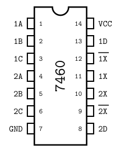
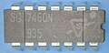
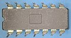
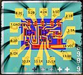

# 60 - dual 4-input expander for 74x23, 74x50, 74x53, 74x55

| | 7460 |
|---|---|
| Manufacturer | Sylvania |
| Date Code | 935 |
| Decap Date | 2017-08-30 |
| Package | Ceramic |
| Top Markings | SG 7460N [Pin 1 marker] / 935 [Logo] |
| Images |     |
| Files | [SVG](svg/7460%20Sylvania%20935%20annotated.svg) |
