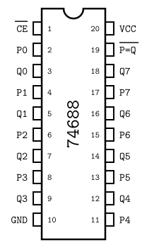
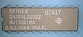
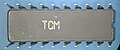
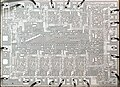

# 688 - 8-bit magnitude comparator, enable

| | 54LS688 |
|---|---|
| Manufacturer | Texas Instruments |
| Date Code | 8741 |
| Decap Date | 2017-08-28 |
| Package | Ceramic |
| Top Markings | TAIWAN 8741Y / SNJ54LS688J / 8415301RA [Logo] / [Pin 1 marker]54LS688/BRAJC |
| Bottom Markings | TCM |
| Images |    |
| Files | [datasheet](datasheet/54LS688_TI_datasheet.pdf) |
