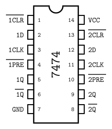
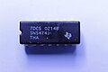
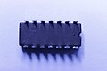
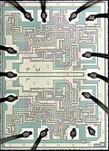
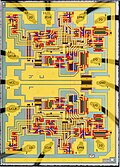
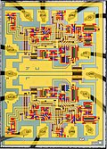
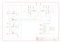

### 74
( dual D positive-edge-triggered flip-flop, asynchronous clear & preset, Q & /Q outputs )

| | 5474 |
|---|---|
| Manufacturer | Texas Instruments |
| Date Code | 0214 |
| Decap Date | 2017-04-08 |
| Transistor Count | 32 |
| Package | Ceramic |
| Top Markings | 7DCS 0214B / SN5474J / THA [Logo] |
| Images |       |
| Files | [KiCad](kicad/5474%20TI%200214%20schematic) [PDF](pdf/5474_TI_0214_schematic.pdf) [SVG](svg/5474%20TI%200214%20annotated.svg) [datasheet](datasheet/5474_TI_datasheet.pdf) |
