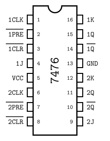
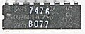
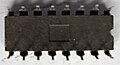
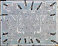
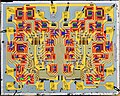
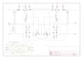

# 76 - dual J-K flip-flop, asynchronous preset and clear

| | 7476 |
|---|---|
| Manufacturer | National Semiconductor |
| Date Code | 7547 |
| Decap Date | 2017-04-14 |
| Transistor Count | 42 |
| Package | Ceramic |
| Top Markings | [Logo] JM385107 / 00204BEB 7547 / 27014 U.S.A. / (vertical)1526 / (superimposed)7476 / (superimposed)B077 |
| IC Donated By | Ken Shirriff |
| Images |       |
| Files | [KiCad](kicad/7476%20NS%20B077%20schematic) [PDF](pdf/7476_NS_B077_schematic.pdf) [SVG](svg/7476%20NS%20B077%20annotated.svg) [datasheet](datasheet/7476_NS_datasheet.pdf) |
