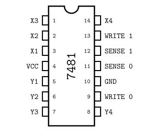
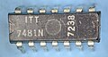
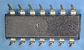
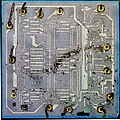
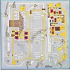
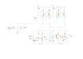

# 81 - 16-bit RAM

| | 7481 |
|---|---|
| Manufacturer | International Telephone and Telegraph Corporation |
| Date Code | 7238 |
| Decap Date | 2017-12-02 |
| Transistor Count | 48 |
| Package | Plastic |
| Top Markings | ITT / 7841N / 7238 |
| IC Donated By | Ken Shirriff |
| Images |      |
| Files | [PDF](pdf/7481_ITT_7238_schematic.pdf) |
