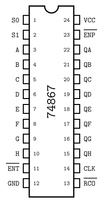
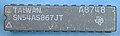
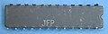
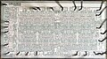

# 867 - synchronous 8-bit up/down counter, asynchronous clear

| | 54AS867 |
|---|---|
| Manufacturer | Texas Instruments |
| Date Code | 8748 |
| Decap Date | 2017-09-04 |
| Package | Ceramic |
| Top Markings | TAIWAN A8748 / SN54AS867JT [Logo] / [Pin 1 marker] |
| Bottom Markings | JFP |
| Images |    |
| Files | [datasheet](datasheet/54AS867_TI_datasheet.pdf) |
