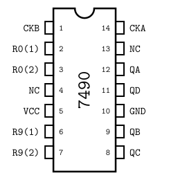
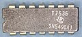
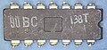
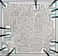
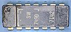
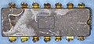
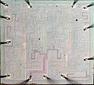

# 90 - decade counter (separate divide-by-2 and divide-by-5 sections)

| | 5490 |
|---|---|
| Manufacturer | Texas Instruments |
| Date Code | 7536 |
| Decap Date | 2018-08-05 |
| Package | Ceramic |
| Top Markings | T7536 / [Logo] / SN5490AJ |
| Bottom Markings | 90BC 138T |
| IC Donated By | Mark Jeronimus |
| Images |    |
| Files | [datasheet](datasheet/5490_TI_datasheet.pdf) |

| | 7490 |
|---|---|
| Manufacturer | Stewart-Warner |
| Date Code | 7142 |
| Decap Date | 2018-08-05 |
| Package | Ceramic |
| Top Markings | [Pin 1 marker] -T / SW / 7490 J / 7142 |
| IC Donated By | Mark Jeronimus |
| Images |    |
