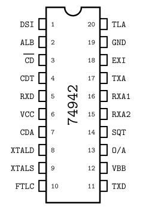
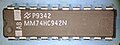
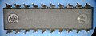
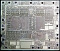
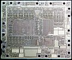

### 942
( 300 baud Bell 103 modem (+/- 5 V supply) )

| | 74HC942 |
|---|---|
| Manufacturer | National Semiconductor |
| Date Code | 9342 |
| Decap Date | 2017-05-20 |
| Package | Plastic |
| Top Markings | [Logo]P9342 / MM74HC942N / (Vertical)AB |
| Bottom Markings | [Logo] (Vertical)AP |
| Images |     |
| Files | [datasheet](datasheet/74HC942_NS_datasheet.pdf) |
