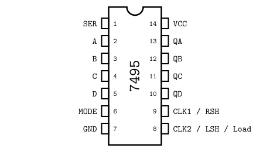
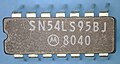
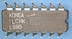
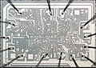

### 95
( 4-bit shift register, parallel in, parallel out, serial input )

| | 54LS95 |
|---|---|
| Manufacturer | Motorola |
| Date Code | 8040 |
| Decap Date | 2017-09-02 |
| Package | Ceramic |
| Top Markings | SN54LS95BJ / [Logo] 8040 |
| Bottom Markings | KOREA / 1LCWK / LS95 |
| Images |    |
| Files | [datasheet](datasheet/54LS95_Motorola_datasheet.pdf) |
