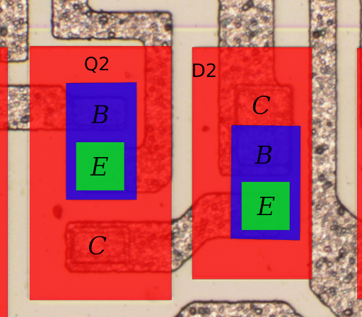
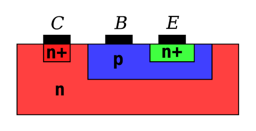
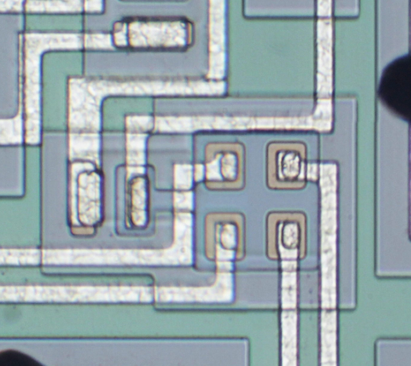
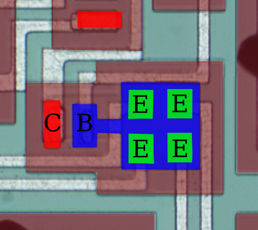
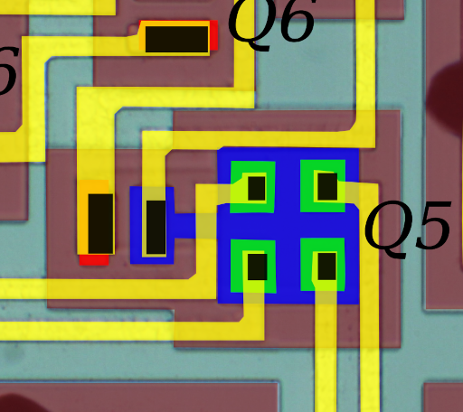

# Reverse Engineering Documentation

1. [Decapsulation](#decapsulation)
2. [Imaging](#imaging)
3. [Stitching](#stitching)
4. [Delayering](#delayering)
5. [Annotation](#annotation)
6. [Schematization](#schematization)

___
## Decapsulation

Most methods are described in detail on [the siliconpr0n wiki](https://siliconpr0n.org/wiki/doku.php?id=decap:start).
Note that many methods are **very dangerous**!
If you still decide to work with H2SO4 or HNO3, make sure you use a fume hood.
If you don't have access to one and decide to use strong acids anyway, go outside, and still wear a _full face mask with acid gas cartridges_.
A single drop in your eye may instantly blind you, and inhaling even a whiff of the fumes can cause severe lung damage.
Even if you think you were safe, hours later you can still die of fluid buildup in your lungs (non-cardiogenic pulmonary edema).
Be very careful!

Luckily a new method was found on the interwebs, and seems to be a lot less dangerous, and that is Colophony.
Colophony, also known as rosin or Greek pitch, is a solid resin obtained from pine trees and other conifers.
It is brittle and translucent at room temperature (ranging from pale yellow to dark amber or black) and melts when heated.
You can buy colophony online through specialty resin, craft, incense, and chemical suppliers, as well as general marketplaces like eBay and Amazon, and musical instrument shops.
Make sure it is pure colophony, and not a mixture.

Here's a short video of [@EvilmonkeyzDesignz](https://www.youtube.com/shorts/WX0XZiBIDp4) dissolving an IC in pure pine gum rosin.

Steps:
* Get rosin, preferably a yellow translucent variant, so you can clearly see when the package is dissolving.
* Heat the rosin up to 275-325 degrees celcius in a test tube with a heat gun, or in a beaker on a hotplate. Do this outside!
* Wait 25-90 minutes. This heavily depends on the thickness of the epoxy. You might grind it down first with a dremel or sander to reduce cooking time.
* Pick out the die with tweezers, or empty the tube/beaker in an empty non-plastic container.
* Rinse the die in lukewarm aceton. This dissolves the resin.
* Depending on the amount of resin used, you can re-use it for a second or third decap.

___
## Imaging

For imaging you need a metallurgic microscope with a decent camera attached, or you can use a DLSR camera with a metallurgic objective directly.
Budget "1000x" digital microscopes on Amazon and AliExpress will not suffice. They have poor (plastic) lenses, a small sensor (couple of MP if you are lucky)
and curved view where the edges are blurry, which ruins stitching. They might work for a quick overview, not detailed inspection.

Plan:
* 10x 0.25 NA or 20x 0.40 NA metallurgic objective with a standard RMS thread (20.32mm)
* RMS-to-M42 adapter (~5mm)
* M42 Extension tubes, standard 3-ring set plus 50mm extension tube (~105-110mm)
* M42 to Four-Thirds (4/3) adapter (**not** micro four-thirds)
* Vertical stand for camera (Olympus E-420 body)
* XY-Z micrometer stage
* Maybe DIY coaxial beam splitter and LED flashlight

___
## Stitching

Use Hugin.
To stitch microscope images of a decapsulated integrated circuit (IC) die in Hugin, use Expert mode with Mosaic translation optimization (X/Y) rather than standard spherical panorama alignment.
Because the microscope stage moves the flat silicon die beneath a stationary lens, standard yaw and pitch rotations will warp the image.
Ensure your microscope tiles have 30% to 50% overlap and fixed manual exposure/white balance so Hugin can match repeating silicon structures.

[Stitching Microscope image using Hugin](https://derekdvleung.wixsite.com/main/post/stitching-microscope-images-using-hugin)

___
## Delayering

Check Robert Baruch's notes on [delayering](procedure/delayering.md)

Really stay away from using pure HF, unless you are absolutely sure what you are doing. It'll work faster, but is extremely dangerous  because it causes both severe local tissue destruction and life-threatening systemic fluoride poisoning. Unlike many other acids, fluoride ions penetrate deep into tissue and bind calcium and magnesium, which can damage bone and disrupt heart rhythm, leading to death.

Using H2O2 + HCl to etch away metal is pretty safe. I have done it multiple times in the past and it was my go-to-method for etching PCBs before Chinese board houses appeared. It's clean. The amount of chlorine gas produced during delayering will be much lower than during the etching of a medium sized PCB. Still, do it outside!

___
## Annotation

Most pages on decapsulation around the internet focus on MOSFETs, and often specifically CMOS logic.
When trying to understand Robert's traces, it took me a while to realize that most of the 74xx families (x,L,S,LS) are not build with MOSFETs at all, but they use NPN [Bipolar Junction Transistors]( https://en.wikipedia.org/wiki/Bipolar_junction_transistor) (BJT). Configured with the base and collector tied together they function like a diode.

Here's both of them captured in the same image (from 5406 TI 8615):

 &nbsp;&nbsp;  &nbsp;&nbsp; 

Red is an N region and corresponds to the collector. Blue is a P region and corresponds to the base of the transistor. Green is an N region and corresponds to the emitter.

Here's a cross-section:

Baruch did not specifically draw the n+ region under the collector, but if you look closely, it's there in the original image.

An example of my 5420 NS 8830 annotation:

 &nbsp;&nbsp;  &nbsp;&nbsp; 

Maroon (dark red) is the n-well, bright red is the n+ collector region. Blue is the p-well, which is the base of the transistor, and green are four n+ emitter regions.

___
## Schematization
